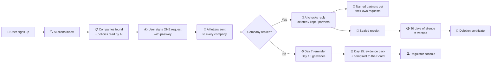

<div align="center">

# 🛡️ TraceErase

### Find it. Delete it. Prove it.

**An AI-powered platform that finds every company holding your personal data, makes them delete it under India's DPDP Act 2023, and gives you tamper-proof proof that they did.**

[**🌐 Live Prototype → trace-erase.web.app**](https://trace-erase.web.app)

Built by **Team Cranial Remission** for **DEXATHON 2026** · Problem Statement 4

</div>

---

## 📌 The Problem

Every app we sign up for collects our name, email, phone number, address and payment details. When we try to take that data back, three things go wrong:

| Problem | What actually happens |
|---|---|
| 🔗 **Copies stay with partners** | Apps share your details with payment, delivery and advertising partners. Your deletion request reaches the app, never the partners it passed your data to. |
| 📧 **"Deleted" is just an email** | A company replies "your data has been deleted". There is no record you can check, show a court, or hold the company to. |
| 🚨 **Leaks show up months later** | Spam calls and emails arrive from companies you never signed up with, and there is no way to know who sold you out. |

India's **Digital Personal Data Protection (DPDP) Act 2023** gives every citizen the right to erasure (Section 12) and the right to know who their data was shared with (Section 11). But using these rights means finding every company, writing legal letters, chasing replies for 30 days and keeping evidence. Almost nobody does it.

---

## 💡 Our Solution

**TraceErase does the whole job for you, end to end:**

1. **🔍 Find:** AI scans who emails you (sender and subject only, never message bodies) and lists every company that has your data, what it holds, and who it shares with.

2. **🛡️ Protect:** Each app can get its own **protected email address**, so if a stranger ever uses it, TraceErase knows exactly which company leaked it.

3. **🗑️ Delete:** One request, signed with your **passkey (fingerprint or face)**, goes to every company you choose and to **every partner each company names in its reply**. Reminders, grievances and complaints follow automatically.

4. **✅ Prove:** AI checks every reply. Every step becomes a **sealed, tamper-proof receipt** that anyone can verify. A **deletion certificate** sums it all up.

> **You clicked delete. Did they?** TraceErase makes sure, and proves it.

---

## ✨ Key Features

### 🔍 Discovery

- **AI inbox scan** from a Gmail export (Google Takeout) or a one-click **sample mailbox**; Gmail connection is awaiting Google approval

- **Live scan screen**: watch companies appear as the Discovery agent finds them

- **Smart results** with filters: *Not used in a year*, *Used this month*, *Shares with partners*, *Needs a web form*

- **AI privacy policy reader**: what each company collects, keeps by law, shares, and how fast it deletes

- **Interactive data map**: You → companies → their partners → leaks

### 🗑️ Deletion

- **One signed request** to many companies at once, signed with a WebAuthn **passkey**

- **AI-written legal letters** citing DPDP Act Section 12(3), in **12 languages**

- **Automatic sending** to each company's grievance or privacy address

- **Partner chain deletion**: when a company names who it shared your data with, those partners get their own requests automatically

- **AI reply checker**: genuine or not, what was deleted, what was kept and under which law

- **Automatic escalation**: reminder on day 7, formal grievance on day 10, complaint ready on day 15

- **Verification by silence**: if no one uses a company-only address for 30 days after it "deleted", the deletion becomes **Verified**

### 🛡️ Protection and leak tracing

- **Protected email per app**, with allowed and blocked senders

- **Leak detection**: a stranger emailing a company-only address is caught and blocked

- **AI leak investigator**: traces which company or partner passed your address on, with a confidence level

- **One-click actions**: block, ask the sender to delete, rotate the address, save evidence, add to complaint

### ✅ Proof and justice

- **Tamper-proof receipts**: every step is fingerprinted (SHA-256) and sealed into a hash-chained Merkle ledger

- **Public receipt verification**: anyone (a company, lawyer or regulator) can check a receipt without an account

- **Evidence packs**, built automatically when a company ignores you or a leak is caught

- **AI-drafted complaints** to the Data Protection Board, filed only with your approval

- **Deletion certificate** with a QR code, downloadable as PDF

- **Public company scores**: who actually deletes on time

### 👤 For everyone

- **Ask TraceErase**: an AI assistant that answers questions about your own data, by text or voice

- **Full activity log** of everything you did and everything TraceErase did

- **12 languages**: English, Hindi, Tamil, Telugu, Kannada, Malayalam, Marathi, Gujarati, Bengali, Arabic, Spanish, French

- **Privacy score**, smart alerts, light and dark themes, adjustable text size, data export and account deletion

### ⚖️ For the Data Protection Board

- **Regulator console**: every filed complaint with its sealed evidence

- **AI pattern detection** across complaints (for example, one ad network behind many leaks)

- **Repeat offender ranking**

---

## ⚙️ How It Works



### The 30-day timeline

| Day | What happens automatically |
|---|---|
| **0** | You sign; AI letters go out; the legal clock starts |
| **7** | Reminder to companies that haven't replied |
| **10** | Formal grievance to the company's grievance officer |
| **15** | Marked overdue: evidence pack and complaint prepared |
| **30** | Legal deadline; silent protected addresses become **Verified** |

### 🤖 The AI agents (Google Gemini)

| Agent | Job |
|---|---|
| **Discovery agent** | Identifies companies from email senders and sorts them by category |
| **Policy reader** | Reads privacy policies and explains what each company keeps and shares |
| **Request writer** | Writes legally correct deletion, reminder, grievance and access letters |
| **Reply checker** | Verifies replies and extracts what was deleted, what was kept and which partners were named |
| **Leak investigator** | Traces who leaked a protected address |
| **Complaint drafter** | Builds a Data Protection Board complaint from the evidence |
| **Assistant** | Answers questions about your data in your language |

> 🔒 **Privacy first:** your name, email and phone number are **masked before anything reaches AI**. AI never reads message bodies. Only fingerprints are sealed in the ledger, never personal data.

---

## 🛠️ Tech Stack

| Layer | Technology |
|---|---|
| **Frontend** | React 19, TypeScript, Vite 6, Tailwind CSS 4 |
| **Backend** | Node.js (zero required dependencies, custom HTTP framework) |
| **AI** | Google Gemini (with built-in rule fallbacks) |
| **Authentication** | Firebase Authentication (email + password, Google) and WebAuthn passkeys |
| **Database** | Cloud Firestore |
| **Hosting** | Firebase Hosting (web app), Render (API server) |
| **Email** | Brevo transactional email API |
| **Proof layer** | SHA-256 fingerprints, Merkle-tree batches, hash-chained ledger (optional blockchain anchoring) |
| **Scheduling** | GitHub Actions (deadline checks and keep-awake every 10 minutes) |
| **Internationalisation** | 12 languages, with live AI translation |

---

## 🚀 Try It Now

### 🌐 Live prototype: **[trace-erase.web.app](https://trace-erase.web.app)**

> ⏳ The free server sleeps when idle, so the first load may take up to a minute.

**Option 1: Demo account (recommended for judges)**

1. Open the site → **Log in** → **Try the demo**

2. On *Connect*, press **Start AI scan** (a sample mailbox is used)

3. Open **Demo controls** (bottom right) → **Run the full story**: companies reply, time moves forward, a leak is traced, a complaint is filed and the certificate is issued

**Option 2: Real account**

1. **Sign up** with your email and password, then confirm your email

2. Choose **Use sample emails** or upload your Google Takeout mail export

3. Select companies → **Delete my data** → **Confirm and send**

**Regulator console:** Log in → *Regulator login* → `regulator@traceerase.demo` / `Regulator@2026`

---

## 💻 Run Locally

```bash
git clone https://github.com/sanchaymurugan22-prog/Trace-Erase.git
cd Trace-Erase
npm install
cp server/.env.example server/.env   # add your GEMINI_API_KEY
npm run dev
```

Open **http://localhost:5173**. Without Firebase settings, the app stores data in a local file and shows emails in a developer outbox, so it runs fully offline apart from AI.

---

## 📁 Project Structure

```
TraceErase/
├── client/          # React + TypeScript web app (all pages, 12 languages)
├── server/          # Node.js API: AI agents, ledger, requests, escalation
├── contracts/       # Optional smart contract for blockchain anchoring
├── cloudflare/      # Email worker for protected inboxes (needs own domain)
├── deploy/          # Scheduled job (keep-awake + deadline checks)
├── firebase.json    # Firebase Hosting config
└── render.yaml      # Render deployment blueprint
```

---

## 🗺️ Roadmap

- [ ] Direct Gmail scanning (pending Google app verification)
- [ ] Own email domain for protected inboxes for every user
- [ ] Protected phone number and SMS verification
- [ ] Public blockchain anchoring of receipt seals
- [ ] Mobile app

---

## 👥 Team Cranial Remission

**Sanchay Murugan** · Sri Krishna Arts and Science College, Coimbatore

GitHub: [@sanchaymurugan22-prog](https://github.com/sanchaymurugan22-prog)

Built for **DEXATHON 2026**.

---

<div align="center">

**🛡️ TraceErase: because "deleted" should mean deleted.**

</div>
